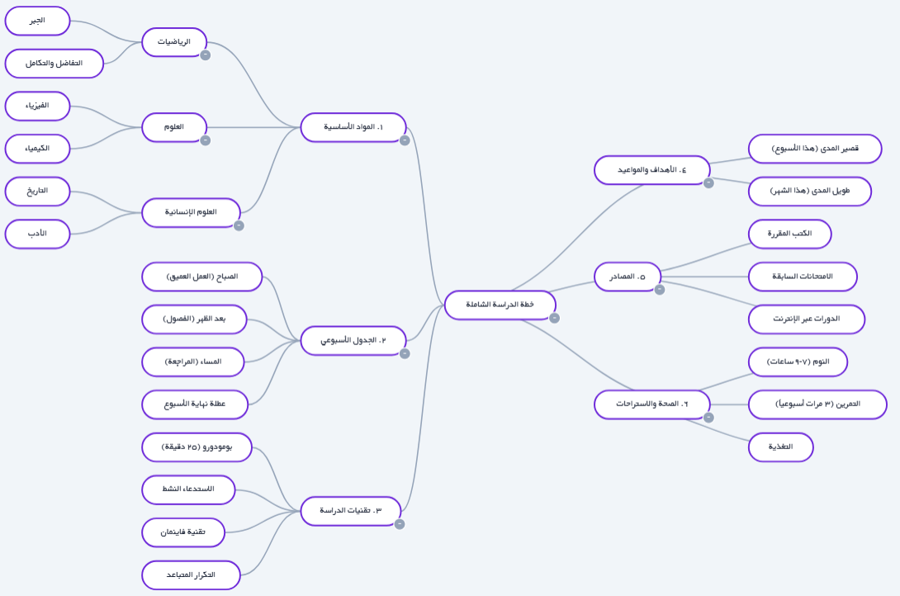

# MindiMap — خرائط ذهنية ومخططات جانت بالذكاء الاصطناعي

🌐 **الموقع الرسمي:** [https://mindimap.com](https://mindimap.com)  
🚀 **الدخول للتطبيق:** [https://mindimap.com/ar/app](https://mindimap.com/ar/app)  
🎥 **مشاهدة العرض:** [Loom Video](https://www.loom.com/share/081675d8aca048fa8adbf2ed0ff6a821)

[English](README.md) | [فارسی](README.fa.md) | [العربية](README.ar.md) | [Русский](README.ru.md) | [Türkçe](README.tr.md) | [中文](README.zh.md)

---

  

## ما هو ميندي ماب؟
ميندي ماب هو تطبيق متكامل لصنع المخططات يعمل بالذكاء الاصطناعي. يجمع بين الخرائط الذهنية، المخططات الانسيابية، إدارة المهام، ومخططات جانت في مساحة عمل واحدة.

## الأدوات الأساسية
### 🧠 الخرائط الذهنية
تخطيط شعاعي أو شجري.

### 📊 المخططات الانسيابية
تصميم الخوارزميات بصرياً.

### ☑ إدارة المهام
قوائم مهام مرئية مع شريط تقدم.

### 📅 مخططات جانت
جداول زمنية كاملة مع التبعيات.

## معرض الصور
| السحب والإفلات | إعادة الربط |
|---|---|
|  |  |

| مخطط جانت | خطة الدراسة (العربية) |
|---|---|
|  |  |

## الأسعار
- **مجاني:** عمليتان.
- **برونزي:** $5.99.
- **فضي:** $6.99.
- **ذهبي:** $17.99.