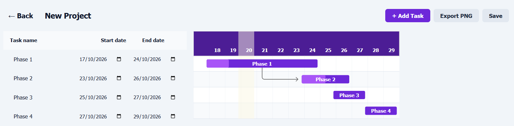
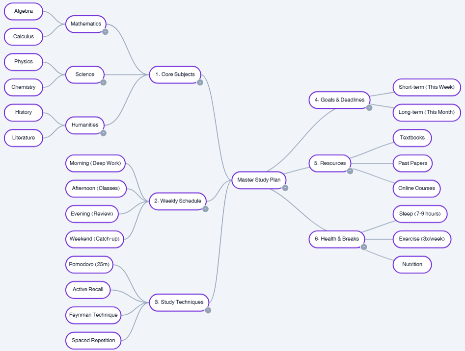
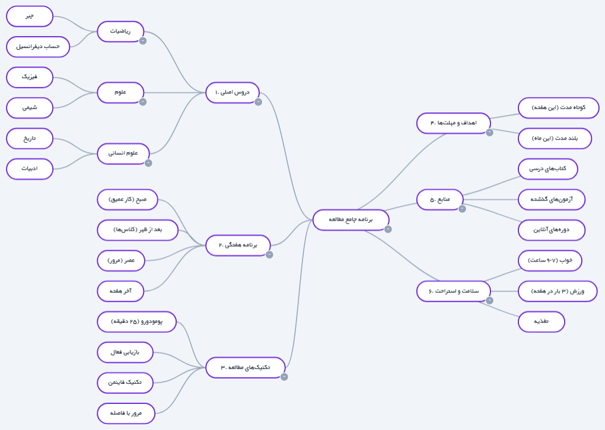

# MindiMap: KI-gestützter Mindmap-, Flussdiagramm- und Gantt-Chart-Generator (kostenlos, im Browser)

[English](README.md) | [فارسی](README.fa.md) | [العربية](README.ar.md) | [Русский](README.ru.md) | [Türkçe](README.tr.md) | [中文](README.zh.md) | [Español](README.es.md) | **Deutsch** | [Italiano](README.it.md)

---

**MindiMap** ist ein kostenloses, browserbasiertes KI-Diagramm-Tool für **Mindmaps**, **Flussdiagramme**, **Aufgabenlisten** und **Gantt-Charts**. Keine Installation. Kein ChatGPT-Konto erforderlich. Funktioniert offline. Der einzige visuelle Denk-Workspace mit **nativer RTL-Unterstützung** (rechts-nach-links) für Persisch und Arabisch ab Tag eins.

> **Jetzt ausprobieren:** [App öffnen](https://mindimap.com/app) — kostenloser Tarif, keine Anmeldung für Ihre erste Karte.

---

## Warum MindiMap anderen Mindmap-Tools vorziehen?

| Funktion | **MindiMap** | [Miro](https://mindimap.com/blog/mindimap-alternative/) | [XMind](https://mindimap.com/blog/mindimap-alternative/) | [SimpleMind](https://mindimap.com/blog/mindimap-alternative/) |
| :--- | :--- | :--- | :--- | :--- |
| **Integrierte KI (kein separates Konto)** | ✅ Enthalten | ❌ Plugin nötig | ❌ Nein | ❌ Nein |
| **Gantt-Charts und Zeitpläne** | ✅ Nativ | ❌ Nur Board | ❌ Nein | ❌ Nein |
| **Vollständiges RTL (Persisch/Arabisch)** | ✅ Erstklassig | ⚠️ Teilweise | ❌ Nein | ❌ Nein |
| **Krypto-Zahlung (BTC / USDT)** | ✅ Ja | ❌ Nur Karten | ❌ Nur Karten | ❌ Nur Karten |
| **Offline (PWA)** | ✅ Ja | ❌ Nein | ⚠️ Desktop | ⚠️ Desktop |
| **14 fertige Vorlagen** | ✅ Ja | ❌ Begrenzt | ⚠️ Einige | ⚠️ Einige |

Lesen Sie den vollständigen [MindiMap vs. Miro, XMind, MindMeister, Lucidchart Vergleich](https://mindimap.com/blog/mindimap-alternative/).

---

## Kernwerkzeuge

### 🧠 Mindmap-Ersteller
Erstellen Sie radiale oder baumartige Mindmaps für Brainstorming, Projektplanung und Notizen. Die KI erzeugt aus einem Satz eine vollständige Hierarchie.

### 🔀 Flussdiagramm-Software
Entwerfen Sie Algorithmen und Prozesse mit 8 Formen, Pfeilspitzen, Ja/Nein-Beschriftungen, Schleifen und Zusammenführungsknoten.

### ☑ Aufgabenverwaltung
Visuelle Aufgabenbäume mit einem Kontrollkästchen pro Knoten und einem Live-Fortschrittsbalken.

### 📅 Gantt-Chart-Generator
Erstellen Sie vollständige Projektzeitpläne mit Meilensteinen und Abhängigkeiten. Oder beschreiben Sie Ihr Projekt in einem Satz und die KI erstellt das gesamte Gantt-Chart.

### 🎤 Sprache zu Mindmap
Beschreiben Sie Ihre Idee laut. MindiMap hört zu, transkribiert Ihre Stimme und erstellt die Karte, während Sie sprechen — kein Tippen nötig. Funktioniert in allen 9 Sprachen.

### 📄 PDF zu Mindmap
Laden Sie ein Forschungspapier hoch und MindiMap extrahiert Zusammenfassung, Methodik, Ergebnisse und Fazit in eine strukturierte Karte.

---

## 14 fertige Vorlagen

Beginnen Sie mit einer **Forschungsarbeit** (vollständige akademische Gliederung: Titel, Abstract, Einleitung, Literaturübersicht, Methodik, Ergebnisse, Diskussion, Referenzen), einem **PRISMA 2020**-Diagramm oder einem dieser:

Projektplan · Lernplan · SWOT-Analyse · Redaktionskalender · Produkt-Roadmap · Wochenaufgaben · Sprint-Planung · Blog-Entwurf · OKRs · Kunden-Onboarding · Reiseplan · Aufgabenliste.

Alle Vorlagen sind vollständig bearbeitbar.

---

## KI-Fähigkeiten

- **Von Grund auf erstellen:** Mindmaps, Flussdiagramme oder Gantt-Charts aus einem einzigen Prompt.
- **Intelligentes Verbessern:** Fügen Sie Knoten hinzu, entfernen oder ordnen Sie sie neu an, während Ihre Notizen, Symbole, Farben und Markierungen erhalten bleiben.
- **Mehrsprachige KI:** Funktioniert in allen 9 unterstützten Sprachen.

---

## 9 Sprachen mit vollständiger RTL-Unterstützung

English · فارسی · العربية · Русский · Türkçe · 中文 · Español · Deutsch · Italiano

Alle neun Sprachen haben eine übersetzte Landing-Page, ein Tutorial und einen Blog. RTL-Sprachen erhalten korrekte Textrichtung, Ausrichtung und KI-Ausgabe.

---

## Galerie & Tutorials

| Knoten ziehen & ablegen | Knoten neu verknüpfen (Teilbaum) |
| :---: | :---: |
|  |  |

| KI-Generator | Gantt-Chart-Fortschritt |
| :---: | :---: |
|  |  |

| Lernplan (Englisch) | Lernplan (Persisch) |
| :---: | :---: |
|  |  |

**Vollständiges Tutorial:** [https://mindimap.com/de/tutorial/](https://mindimap.com/de/tutorial/)  
**Prompt-Leitfaden:** [https://mindimap.com/de/guide.html](https://mindimap.com/de/guide.html)  
**Blog:** [https://mindimap.com/de/blog/](https://mindimap.com/de/blog/)

---

## Technologie-Stack (Überblick)

| Schicht | Technologie |
| :--- | :--- |
| Backend | Serverseitige PHP-API |
| Cloud-Speicher | Sicher gehostete Datenbank |
| Zahlung | Bitcoin, USDT und Kartenabwicklung |
| Hosting | Managed Shared Hosting mit CDN |

*Der Quellcode ist proprietär. Dieses Repository ist ein Showcase, nicht der vollständige Produktcode.*

---

## Preise

| Plan | Preis | KI-Läufe | Dauer |
| :--- | :--- | :--- | :--- |
| **Kostenlos** | $0 | 2 lebenslang | — |
| **Bronze** | $5.99 | 60 | 30 Tage |
| **Silber** | $6.99 | 150 | 60 Tage |
| **Gold** | $17.99 | 600 | 180 Tage |

Kostenlos beinhaltet außerdem: 7 Mindmaps, 1 Flussdiagramm, 1 Cloud-Backup, 1 Wiederherstellung.

Bezahlung mit **Bitcoin** oder **USDT (TRC-20)**.

---

## FAQ

<strong>Ist MindiMap kostenlos?</strong>

Ja. Der kostenlose Tarif umfasst 7 Mindmaps, 1 Flussdiagramm, 1 Cloud-Backup, 1 Wiederherstellung und 2 lebenslange KI-Läufe. Bezahlte Pläne beginnen bei $5.99.

<strong>Braucht man ein ChatGPT-Konto?</strong>

Nein. Die KI läuft auf MindiMap-Servern. Sie brauchen kein OpenAI-, Anthropic- oder Google-Konto.

<strong>Werden Persisch und Arabisch unterstützt?</strong>

Ja. Persisch und Arabisch sind erstklassig, mit vollständigem RTL-Layout, Textrichtung und KI-Ausgabe. Neun Sprachen werden unterstützt.

<strong>Funktioniert es offline?</strong>

Ja. Nach einmaligem Laden der App können Sie Karten ohne Internet erstellen und bearbeiten. KI und Cloud-Backup benötigen eine Verbindung.

<strong>Wie bezahle ich?</strong>

Bezahlung mit **Bitcoin** oder **USDT (TRC-20)**.

---

## Mitwirken & Feedback

Dies ist ein **Showcase-Repository**, nicht der Produktquellcode. Probleme und Funktionswünsche sind willkommen — eröffnen Sie ein Issue in diesem Repo oder schreiben Sie an [info@mindimap.com](mailto:info@mindimap.com).

Wenn Sie MindiMap nützlich finden, **geben Sie diesem Repo einen Stern**, damit andere es entdecken.

---

## Schlüsselwörter & Themen

`mindmap` · `mind map` · `flussdiagramm` · `flowchart` · `gantt-chart` · `künstliche intelligenz` · `ai-diagram-generator` · `rtl-support` · `german` · `persian` · `productivity`

---

## Lizenz

Proprietär. Siehe [LICENSE](LICENSE). Die MindiMap-Anwendung und ihr Quellcode sind kommerzielle Produkte.