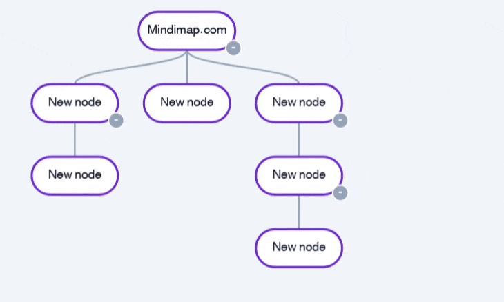
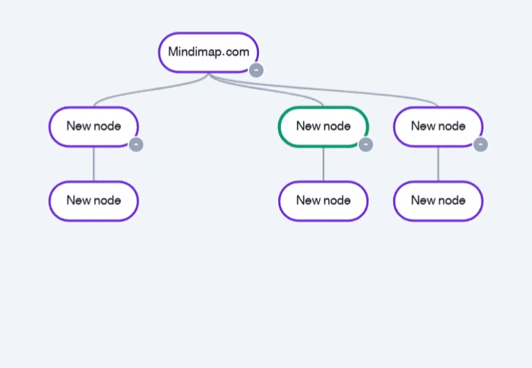
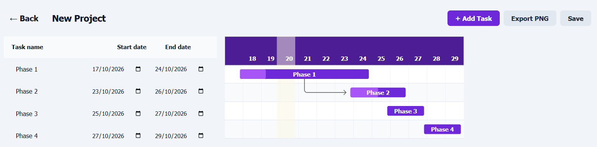
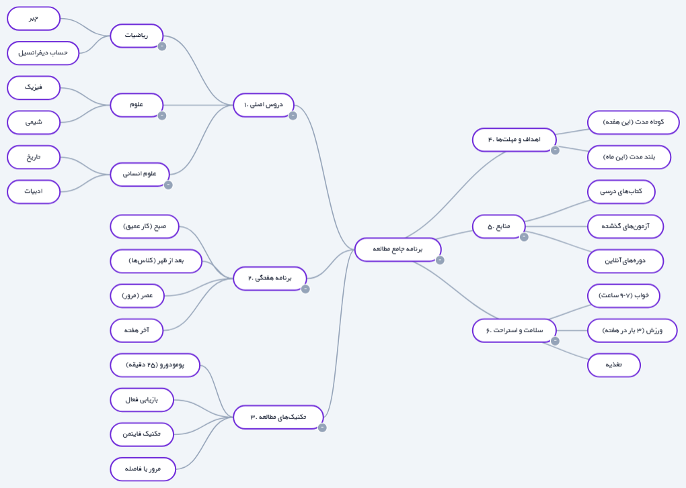

# MindiMap — ساخت نقشه ذهنی، فلوچارت و چارت گانت با هوش مصنوعی

🌐 **وب‌سایت رسمی:** [https://mindimap.com](https://mindimap.com)  
🚀 **ورود به برنامه:** [https://mindimap.com/fa/app](https://mindimap.com/fa/app)  
🎥 **تماشای دمو:** [Loom Video](https://www.loom.com/share/081675d8aca048fa8adbf2ed0ff6a821)

[English](README.md) | [فارسی](README.fa.md) | [العربية](README.ar.md) | [Русский](README.ru.md) | [Türkçe](README.tr.md) | [中文](README.zh.md)

---

  

## مایندی مپ چیست؟
مایندی مپ یک مجموعه ابزار بصری و دیاگرام‌ساز مبتنی بر هوش مصنوعی است که نقشه‌های ذهنی، فلوچارت‌ها، مدیریت کارها و چارت‌های گانت را در یک محیط یکپارچه ترکیب می‌کند. هوش مصنوعی داخلی آن می‌تواند در چند ثانیه یک ساختار کامل را از یک جمله بسازد. این اولین ابزار جهان است که پشتیبانی کامل و بومی از زبان‌های راست‌به‌چپ (فارسی و عربی) دارد.

## ابزارهای اصلی
### 🧠 نقشه‌های ذهنی
چیدمان شعاعی یا درختی برای طوفان فکری و برنامه‌ریزی.

### 📊 فلوچارت‌ها
طراحی الگوریتم‌ها با ۸ نوع شکل.

### ☑ مدیریت کارها
هر گره یک کار با چک‌باکس و نوار پیشرفت زنده است.

### 📅 چارت‌های گانت
جدول زمانی کامل پروژه. ایده‌آل برای گزارش‌های شرکتی و پایان‌نامه.

## گالری
| کشیدن و رها کردن | اتصال مجدد گره‌ها |
|---|---|
|  |  |

| چارت گانت | برنامه مطالعه (فارسی) |
|---|---|
|  |  |

## قیمت‌گذاری
- **رایگان:** ۲ بار استفاده.
- **برنزی:** $5.99.
- **نقره‌ای:** $6.99.
- **طلایی:** $17.99.

پرداخت با **بیت‌کوین**، **USDT** یا کارت‌های بین‌المللی.